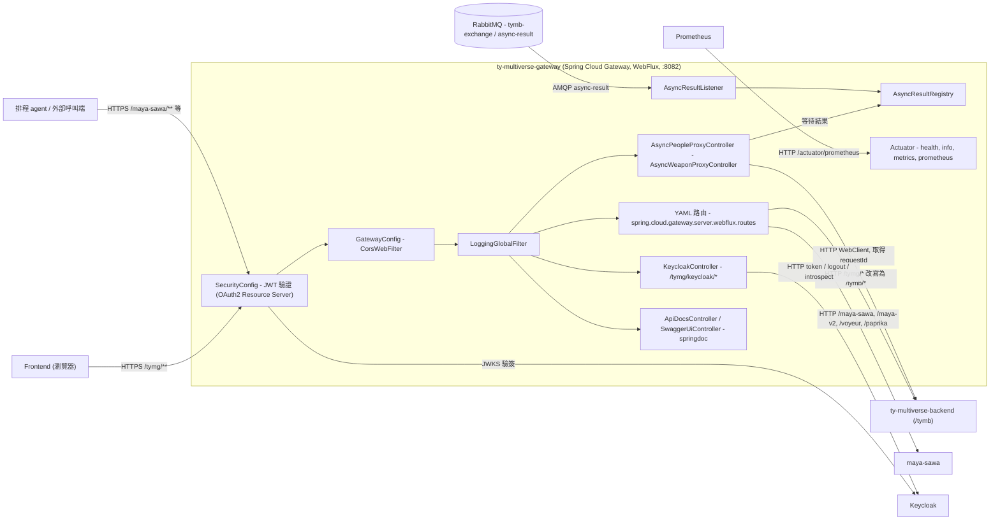
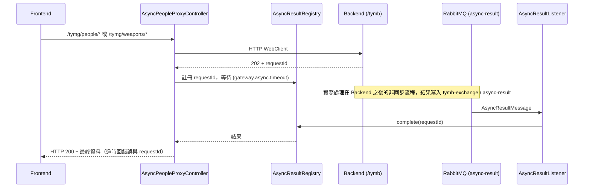

# TY Multiverse Gateway

 

> The unified API gateway and routing layer for the system, featuring rate limiting, circuit breaking, and centralized security.

## Table of Contents

- [Background](#background)
- [Architecture](#architecture)
- [Design Patterns](#design-patterns)
- [Other](#other)

## Background

### 性能特性

- **反應式架構**：基於 Spring WebFlux，非阻塞 I/O，事件驅動，高併發處理
- **連接池管理**：HTTP + Redis 連接池，自動連接重用
- **超時配置**：connect-timeout 10s，response-timeout 30s

### 安全特性

- **CORS 配置**：限制允許的來源和方法
- **Rate Limiting**：基於 IP 或用戶的分散式限流（Redis 令牌桶）
- **Circuit Breaker**：Resilience4j 熔斷，防止級聯失敗

### 路由配置

| 路徑 | 目標服務 | 說明 |
|------|---------|------|
| `/tymg/people/**` | Backend（`AsyncPeopleProxyController`） | 人物管理 API（非同步代理） |
| `/tymg/weapons/**` | Backend | 武器管理 API |
| `/tymg/gallery/**` | Backend | 圖庫管理 API |
| `/tymg/deckofcards/**` | Backend | 21點遊戲 API |
| `/tymg/learn/**` | Backend | 學習模組 API |
| `/tymg/palais-access/**` | Backend | Palais 存取審核 API |
| `/tymg/auth/**` | Backend | 認證 API |
| `/tymg/keycloak/**` | Gateway 自身 `KeycloakController` | Keycloak 登入回呼、登出、introspect |
| `/tymg/api/request-status/**` | Backend | 異步請求狀態 |
| `/maya-sawa/**`、`/maya-v2/**`、`/voyeur/**`、`/paprika/**` | maya-sawa | Maya 服務 |

## Architecture

### 整體架構



### 非同步代理流程（`controller/BaseAsyncProxyController.java`、`service/`）



### 請求流程

```
客戶端請求 → SecurityConfig (JWT) → CorsWebFilter → LoggingGlobalFilter
→ 路由匹配（YAML 路由或 Async*ProxyController）→ 轉發到 Backend / maya-sawa → 返回響應
```

## Design Patterns

### 🎯 設計模式 (Design Patterns)

- **API 閘道 / 外觀模式 (API Gateway / Facade)**: 將多個微服務呼叫收斂於單一入口點，提供統一介面。
- **過濾器模式 (Filter Pattern)**: 利用 Spring Cloud Gateway 的 Global Filter 攔截並修改 HTTP 請求與響應。
- **熔斷器模式 (Circuit Breaker)**: 引入 Resilience4j 防止後端雪崩效應，實作自動狀態切換及降級機制。

## Other

### 服務端點

- **Gateway API**: `http://localhost:8082`
- **健康檢查**: `http://localhost:8082/actuator/health`
- **路由資訊**: `http://localhost:8082/api-docs/routes`（actuator 的 `gateway` 端點已關閉）

### 技術棧

- Spring Boot 3.5.16 / Spring Cloud 2025.0.3（Gateway 4.3）/ Java 21
- Redis（分散式限流）/ Resilience4j（熔斷器）

> 啟動指令、API 測試 curl 範例、Docker/K8s 部署、性能調優請見 [AGENTS.md](AGENTS.md)。

Maya 經 Gateway 轉發的規劃見[執行計畫](docs/routing/MAYA_BEHIND_GATEWAY_PLAN.md)。
