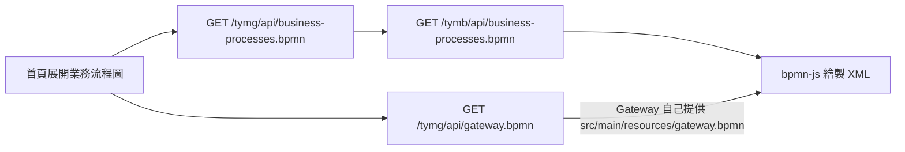

# 公開 BPMN 路由

## 開發方法

1. 使用獨立的 GET 路由與精確路徑，讓匿名訪客可看公開的靜態 BPMN。Backend 目標沿用 `BACKEND_BASE_URL`。
2. 用 `mvn test -Dtest=MayaRoutingTest` 驗證匿名 GET 的轉發路徑，以及匿名 POST 仍受保護。
3. 先確認 Backend 已提供 XML，再部署 Gateway，最後驗證首頁展開和正式 GET 回應。本路由不需要新憑證。

The Palais access diagram is available at GET /tymg/api/palais-access.bpmn. The gateway forwards it to Backend as a public document. Live applications and audit data use the separate authenticated /tymg/palais-access/** route.

首頁選單提供 Gateway 與 Backend 兩張圖。`gateway.bpmn` 由 Gateway 人工維護；新增或改路由、放行規則時一併更新。部署順序：Gateway 先，前端後。
