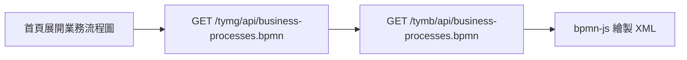

# 公開 BPMN 路由

## 開發方法

1. 使用獨立的 GET 路由與精確路徑，讓匿名訪客可看公開的靜態 BPMN。Backend 目標沿用 `BACKEND_BASE_URL`。
2. 用 `mvn test -Dtest=MayaRoutingTest` 驗證匿名 GET 的轉發路徑，以及匿名 POST 仍受保護。
3. 先確認 Backend 已提供 XML，再部署 Gateway，最後驗證首頁展開和正式 GET 回應。本路由不需要新憑證。
