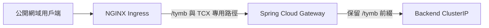

# Backend 公開路由

## 開發方法

1. 先用 `mvn -P platform -Dtest=BackendRoutingTest test` 重現路由缺失與跨來源請求失敗。測試涵蓋 backend 健康檢查、401、預檢及大於 1 MiB 的資料完整性。以 `mvn -P platform test` 驗證既有路由。
2. Backend 繼續驗證權杖並處理 CORS。Gateway 保留原始請求，包括 OPTIONS 預檢。NGINX 傳遞來源資訊，Gateway 附加代理節點。Backend 的現有業務授權與限流沒有使用來源 IP。
3. 專用 Ingress 的 Exact 路徑開放 30 MiB 並停用 request buffering。Gateway 的 RequestSize 檢查 Content-Length，NGINX 對包含 chunked 在內的公開上傳強制上限。Backend 保留串流上限。其餘路徑沿用 ingress-nginx 的預設 1 MiB。
4. 先部署 Gateway 並從叢集內驗證其 200、401 和預檢。從兩份來源 YAML 各抽出一組 Prefix／Exact Ingress，先做 server dry-run，再依新網域、舊網域逐一套用並驗收。
5. 每個網域切換前保留原 Prefix Ingress。回復 Gateway 可用版本時，可用 `kubectl rollout undo deployment/ty-multiverse-gateway --to-revision=<已驗證版本>`。若只有 TCX 專用規則異常，可先用 `kubectl delete ingress <原名稱>-tcx` 回復 1 MiB 上限，Prefix 仍經 Gateway。若需撤下整個入口，先從管理端保留對應規則，再移除該網域的 Prefix／Exact Ingress。
6. 使用既有的 `X-Health-Token` 驗證無效 TCX 回 400，測試內容不得包含真實活動。憑證由既有 Kubernetes secret 注入 backend。從外部確認 200／401／413，並查核沒有 Ingress 指向 backend Service。
