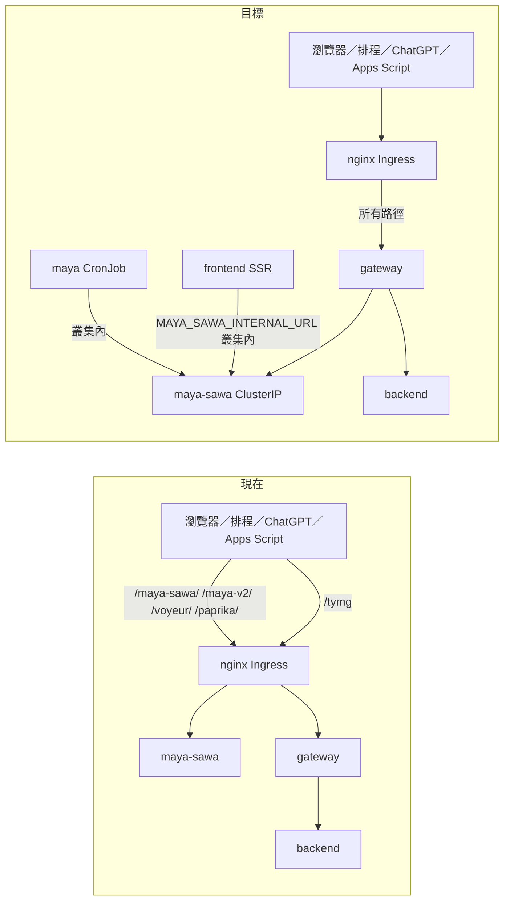

# Maya Sawa 只經 Gateway 對外：執行計畫

狀態：計畫（2026-11-13），尚未動工。執行者先讀 skill `maya-behind-gateway`（`.claude/skills/maya-behind-gateway/SKILL.md`）。

## 目標

Maya Sawa 不再有任何 Ingress，只剩 ClusterIP Service。網際網路上唯一能到 Maya 的路是 Gateway。
對外網址（`https://tymultiverse.cc/maya-sawa/...` 等）**完全不變**，所以前端、雲端排程 prompt、ChatGPT 每日任務、Apps Script 都不用改。

## 已查證的事實（2026-11-13）

| 項目 | 現況 | 影響 |
|---|---|---|
| Gateway 技術 | Spring Cloud Gateway 3.2.7 + WebFlux（Netty，非阻塞） | 長請求不占執行緒，只需調逾時 |
| Gateway 現有 filter | `LoggingGlobalFilter` 不讀 body | 1GB 串流上傳可行；新增 filter 不可讀 body |
| Gateway 安全 | `SecurityConfig` 結尾 `anyExchange().authenticated()` | **Maya 路徑若不先 permitAll，全部 401** |
| Gateway 資源 | replicas 1；CPU req 20m / limit 500m；mem limit 512Mi | 單點；切換後觀察 |
| Maya Ingress #1 | `maya-sawa/k8s/deployment.yaml` 的 `maya-sawa-ingress`（舊網域 peoplesystem.tatdvsonorth.com） | 要刪 |
| Maya Ingress #2 | `peoplesystem-terraform-oke/tymultiverse-domain/mirror-ingress.yaml` 的 `tymcc-maya-sawa`，另有 `tymcc-portfolio-api-protected`（Exact `/api/market/portfolio` → maya） | 改指 gateway |
| 路徑 | `/maya-sawa/`、`/maya-v2/`、`/voyeur/`、`/paprika/` | 四條都要轉 |
| Maya 時限 | proxy-read/send-timeout 1800s；body 1024m；request buffering off | Gateway 要對齊 |
| 叢集 CNI | flannel（`cni_type = "flannel"`） | **NetworkPolicy 不會被執行**，見階段 3 |
| 叢集內呼叫者 | frontend SSR（`http://maya-sawa/maya-sawa`）、maya CronJob、backend activity log | 不經 Gateway，不受影響 |

## 階段

每個階段獨立 commit、獨立部署、可單獨回退。前一階段在 prod 驗證通過才進下一階段。

### 階段 1：Gateway 加 Maya 路由（不影響現有流量）

1. `application.yml` 加四條 route，`uri: ${MAYA_SAWA_BASE_URL:http://maya-sawa}`，**路徑原樣轉發，不 RewritePath**。
   Predicate 用 `Path=/maya-sawa/**` 等，不要加 `/tymg` 前綴（對外網址不能變）。
2. `SecurityConfig`：四個前綴 `permitAll()`，寫在 `anyExchange()` 之前。驗證此階段仍由 Maya 自己做。
   注意 `CustomBearerTokenResolver`：permitAll 路徑帶了 Maya 用的 token 或 agent key 時，Gateway 不可因 JWT 解析失敗而 401。寫測試證明。
3. 逾時與大小：`spring.cloud.gateway.httpclient.response-timeout: 1800s`、`connect-timeout: 30000`；確認沒有限制 request body 大小的設定。可用 route `metadata.response-timeout` 只對 Maya 路由拉長。
4. CORS：Gateway 的 `CorsWebFilter` 與 Maya 自己的 CORS 會重複加 header。Maya 路由排除 Gateway CORS，或用現有 `DedupeResponseHeader` 驗證只剩一份。
5. 來源 IP：確認 Gateway 帶 `X-Forwarded-For`，Maya 的 IP 相關邏輯（限流、日誌）仍取得真實 client IP。
6. k8s：`deployment.yaml` 加 env `MAYA_SAWA_BASE_URL=http://maya-sawa`。
7. 測試（`tdd-workflow`）：路由轉發、permitAll、帶 Bearer／agent key 不被 Gateway 擋、串流上傳不緩衝、長回應不被切。
8. Prod 驗證：叢集內 `kubectl exec` 打 `http://ty-multiverse-gateway-service:8082/maya-sawa/health`（或任一公開 GET）回 200，內容與直打 Maya 相同。

### 階段 2：Ingress 切到 Gateway（真正改變對外路徑）

1. `mirror-ingress.yaml`：`tymcc-maya-sawa` 四條路徑與 `tymcc-portfolio-api-protected` 的 backend 改為 `ty-multiverse-gateway-service:8082`。nginx annotations（1024m、1800s、buffering off）保留，Gateway 前面那層 nginx 也要放行大檔與長請求。
2. `maya-sawa/k8s/deployment.yaml`：刪除 `maya-sawa-ingress`。舊網域 peoplesystem.tatdvsonorth.com 仍需服務（Apps Script、ChatGPT connector 用），在 gateway 側新增同 host 的 Ingress 指向 Gateway，**不可回 301**。注意 admission webhook 不允許兩個 Ingress 宣告同 host+path。
3. 切換順序：先 apply 新規則指向 Gateway，確認通，再刪 Maya 的 Ingress。
4. 驗證清單（外網）：
   - 首頁、報告頁、總經頁正常（SSR 不受影響，但瀏覽器直呼的 `/maya-sawa/market/taiex-futures`、`voyeur/*`、`qa/*`、`maya-v2/*` 要通）
   - 雲端排程用 agent key 的 GET／PUT 成功（看下一次 routine 執行結果）
   - Live 影片上傳 4 支大檔成功
   - `/api/market/portfolio` 未登入仍被擋
5. 回退：把 Ingress backend 改回 `maya-sawa:80`。

### 階段 3：讓 Maya 真的繞不過去

Maya 沒有 Ingress 後，網際網路已無法直連。剩下的風險只在叢集內。
flannel 不執行 NetworkPolicy，所以：

- 選項 A（建議，零成本）：不寫 NetworkPolicy，改為 Jenkins／Ingress 防呆：CI 檢查任何 Ingress 的 backend 不得是 `maya-sawa`。
- 選項 B：在 OKE 加裝 Calico policy-only 模式後才寫 NetworkPolicy。會吃 node 資源（兩台 1vCPU），需使用者同意。

**不要寫一份不會被執行的 NetworkPolicy 然後宣稱已鎖住。**

### 階段 4：驗證與限流收進 Gateway（另開計畫）

- Gateway 驗 Keycloak JWT，覆寫外部帶入的 `X-User`／`X-Roles`，Maya 改信任 header。
- 限流用 `RequestRateLimiter` + 現有 Redis（`application.yml` 已有被註解的 Redis 設定）。
- agent key 與擁有者權限檢查先留在 Maya。
- 前提：階段 2 完成，否則 Maya 信任 header 會被直連偽造。

## 監控（階段 2 之後一到兩天）

`ssh oke-node "kubectl top pod -l app=ty-multiverse-gateway"`：CPU 接近 500m 或記憶體接近 512Mi 才調；不要先加。Gateway 掛了 Maya 就斷，考慮 replicas 2（注意 node 資源）或至少確認 readiness probe。

## 不做的事

- 不改前端、排程 prompt、ChatGPT 任務的網址。
- 不在此計畫內動 Celery／MQ。
- 不在叢集內呼叫（SSR、CronJob、backend）加 Gateway 這一跳。
