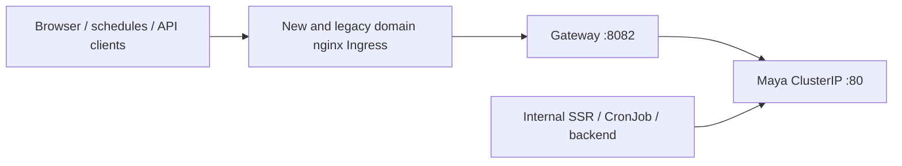

# Maya Gateway phase 2 — 2026-11-13

Phase 1 was accepted in production before this change. Phase 2 is deployed.

The existing `maya-sawa-ingress` and `portfolio-api-protected-ingress` names are retained to update host/path rules in place without an admission conflict or deletion gap. Their manifests now belong to Gateway (`k8s/maya-ingress.yaml`); Maya's deployment manifest no longer declares an Ingress. Both new-domain rules remain in the infrastructure repo's `mirror-ingress.yaml`. Every backend now targets Gateway. No Ingress should target the Maya service directly.

## 開發方法

1. Capture the four live Ingress objects before changing traffic: the on-node rollback snapshot is `/tmp/maya-stage2-ingress-before.json` (temporary, not a durable backup).
2. First run manifest tests against the old files: they fail because the Gateway manifest is absent and Maya still publishes its own Ingress. Move the legacy manifest, retain TLS and upload/timeout annotations, and change all four Ingress backends to `ty-multiverse-gateway-service:8082`. Include the discovered legacy exact portfolio path `/tymultiverse/api/market/portfolio`.
3. Run `python -m unittest discover -s tests -p test_maya_ingress.py` from Gateway in the multi-repo workspace (requires PyYAML). These cross-repo acceptance tests require the sibling Maya and infrastructure repositories. Both tests now pass.
4. Server-side dry-run all four selected Ingress documents before applying only those documents; avoid applying unrelated Deployment or Ingress resources.
5. External HTTPS checks on both domains return 200 for taiex-futures, voyeur count, available-models and paprika/up. Protected portfolio returns 401. All responses carry `X-Gateway-Response: TYM-Gateway` and a single CORS allow-origin header. Legacy URLs are retained.
6. No new credentials or user data are needed for this change. Existing TLS secret names remain unchanged. Internal direct Service callers remain unchanged.

## Remaining validation

No live video upload, 1GB upload, 1800-second response, paid AI call, real social publication or authenticated schedule write was triggered. Validate upload during the next intended Live use and inspect the next scheduled routine result. This change does not implement phase 3 or 4.

## Rollback

Restore the four saved Ingress specs with `kubectl apply -f /tmp/maya-stage2-ingress-before.json` on the operator node. If the temporary snapshot is unavailable, set each of these four Ingress backends to `maya-sawa:80`, preserving their paths, annotations and TLS settings. Revert the matching repository changes as well so future deployments preserve the rollback. Keep the phase-1 Gateway routes available.
